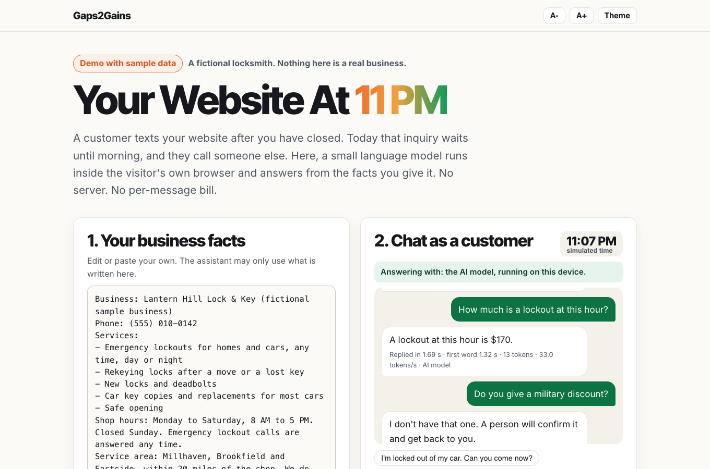
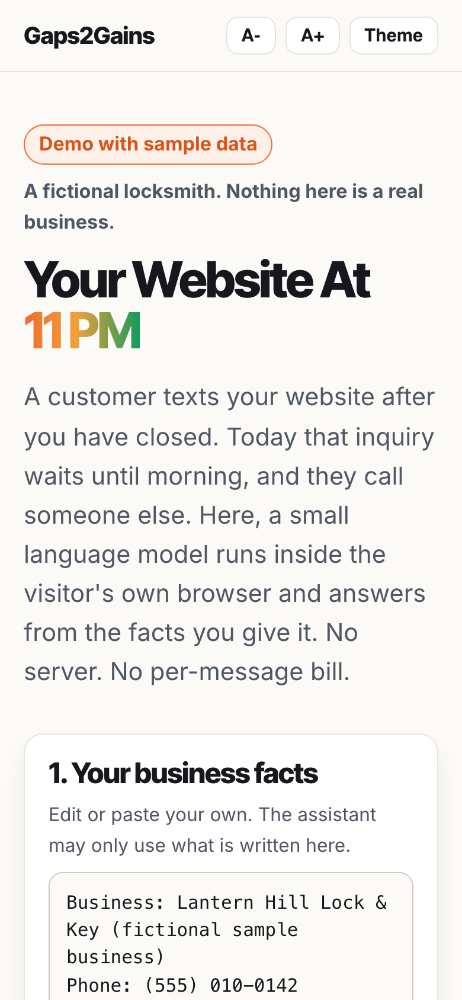

# Your Website At 11 PM

**Demo with sample data.** A fictional locksmith (Lantern Hill Lock & Key) answers a customer at a simulated 11:07 PM. A small language model runs inside the visitor's own browser, so there is no server and no API bill. An Owner can paste or edit a short block of business facts and chat as a customer.

A Gaps2Gains portfolio demo. For the plain-English decision notes, see [docs/BRIEF.md](docs/BRIEF.md). Next step for a buyer: the [14-Day Business Diagnosis](https://gaps2gains.com/diagnosis).



| Mobile, AI model | Mobile, no WebGPU (Instant mode) |
| --- | --- |
|  |  |

More: [desktop fallback](docs/screenshots/fallback-desktop-top.png), [desktop full page](docs/screenshots/fallback-desktop-full.png), [mobile full page](docs/screenshots/fallback-mobile-full.png).

## What it does

- One static page. Edit the business facts, then chat as a customer.
- The model answers only from the facts, and says "A person will confirm it and get back to you" for anything else.
- A real reply timer: measured with `performance.now()` from Send to the last word, plus time to the first word and tokens per second when the engine reports it. Nothing is hardcoded. The "11:07 PM" badge is labeled as simulated time.
- No WebGPU, or before the model is loaded: **Instant mode**, a plain keyword lookup over the same facts, labeled "not AI" on screen with its own timer label.
- The 880 MB first download only starts on a button press, with the size stated up front and a progress bar. The browser caches it afterward.
- Plain-English warning on the page that small models can be wrong, with the measured test results.

## Upstream and new

**Upstream (not written here):**
- [web-llm](https://github.com/mlc-ai/web-llm) by the MLC AI project, Apache 2.0. It runs the model in the browser through WebGPU. Installed unchanged from npm (`@mlc-ai/web-llm`, version in `package-lock.json`); its license ships in `node_modules/@mlc-ai/web-llm/LICENSE`.
- The model: Qwen2.5 1.5B Instruct (Apache 2.0), 4-bit build published by MLC AI on Hugging Face.
- Vite (build tool), Inter and Inter Tight fonts through Fontsource.

**New in this repo:** the page and design, the facts editor, the prompt, the fact-match gate, the number check, Instant mode, the timer and progress UI, the scripted tests, and the docs.

## Where the model files are hosted, and cost

- Weights: Hugging Face, `mlc-ai/Qwen2.5-1.5B-Instruct-q4f16_1-MLC`. Public, not gated, no account, no fee (checked through the Hugging Face API and a plain download).
- Compiled GPU program (`.wasm`): the web-llm project's GitHub repo, `mlc-ai/binary-mlc-llm-libs`, fetched from `raw.githubusercontent.com`. Public, no account, no fee.
- Both are third parties. When a visitor presses the load button, their browser contacts those two hosts. If either changes or goes down, the model path breaks. A production version should copy the files to the Owner's own hosting.
- Zero cost to run: no keys, no signups, no server. The visitor's device does the work.

## Run it

Needs Node 20 or newer.

```bash
npm ci --ignore-scripts
npm run build          # static files in dist/
npm run preview        # http://localhost:4173
npm test               # unit tests, regression tests, tuned and fresh-question Instant mode scoring (no browser needed)
npx playwright install chromium   # once, for the browser tests
node tests/fallback.mjs           # browser test of the no-WebGPU path (preview must be running)
npm run test:model                # runs the real model, needs WebGPU, downloads ~880 MB once
npm run shots                     # screenshots into docs/screenshots (add -- --model for model shots)
```

WebGPU needs a secure context (`https` or `localhost`). Opening `dist/index.html` from a `file://` path will not run the model. Serve `dist/` with any static server.

## Status (what was actually tested)

Tested on 2026-11-06, one Mac, headless Chromium 158 driven by Playwright.

- **Fallback path, tested first:** in a default headless Chromium with no usable graphics adapter, the page detected it, hid the load button, showed the "cannot run the AI model" message, and the chat answered in Instant mode with an honest timer label. Passing (`tests/fallback.mjs`), no horizontal scroll at desktop and mobile sizes.
- **Model path: it was run.** That browser had no WebGPU by default, so the model path was tested separately with WebGPU flags on (`--enable-unsafe-webgpu`, Metal). With them the model downloaded (about 9 minutes on my connection the first time, about 1 to 2 seconds from cache afterward) and answered. Not tested: a stock, unflagged Chrome; Edge; Firefox; Safari; any phone; the 32-bit variant used by GPUs without `shader-f16`; Windows or Linux.
- **Scripted questions** (24: 12 with the answer in the facts, 12 without). Full transcripts are in `docs/`. Grading is automatic and strict.

| Setup | Known questions answered right | Unknown questions handed off | Notes |
| --- | --- | --- | --- |
| Qwen2.5 0.5B, first prompt | 9 of 12 | **0 of 12** | made things up ("we accept checks", "we serve Riverside County") |
| Qwen2.5 0.5B, tuned prompt | 9 of 12 | 4 of 12 | still unreliable |
| Qwen2.5 1.5B, tuned prompt | 10 of 12 | 9 of 12 | |
| **Qwen2.5 1.5B, tuned prompt + fact-match gate (shipped)** | **10 of 12** | **11 of 12** | median model reply about 1.7 s (13 replies that ran the model) |
| Instant mode (keyword lookup, no AI) | 11 of 12 | 11 of 12 | sub-millisecond |

- The 0.5B model was rejected because it did not stick to the facts. 1.5B is the smallest model I tried that was usable. I did not test other model families.
- Not fixed: the "No available adapters" lines in the console on browsers without WebGPU come from the browser itself, not from this page's code.
- Honest caveats: the prompt and the gate were tuned while looking at these same 24 questions, so real-world results will likely be worse. One run each at temperature 0. The remaining misses on 1.5B: it handed off "Are you open on Sunday?" and "Can you rekey my locks?" although the facts answer both, and for "How much to open my safe?" it asked for details instead of handing off (the facts say safes are quoted after seeing the job). Instant mode's one miss on a known question is "What do you need from me for a lockout?", and on the safe question it returns the correct quote line, which the strict grader counts as a miss.
- **Instant mode, after the audit fixes (2026-11-06).** An outside audit found Instant mode answered only 6 of 20 fresh in-facts questions and failed the page's own first suggested chip. The lookup was loosened (filler words no longer force a handoff, more synonyms, times like "11 PM" understood, price lines preferred for price questions, greetings answered, lines separated by line breaks). Scores now:

| Question set | Answers right | Handoffs right | Notes |
| --- | --- | --- | --- |
| The 24 scripted questions (tuned on) | 12 of 12 | 11 of 12 | tuned, so flattering |
| 24 audit questions and chips (tuned on) | all pass | all pass | tuned, so flattering. `tests/regression.mjs` |
| **40 fresh questions, never tuned on** (`tests/heldout-set.js`) | **20 of 24** | **16 of 16** | **36 of 40 overall.** Before the fixes the same questions scored 26 of 40 (answers 10 of 24). |

The fresh set was written before the lookup was changed and was not edited afterward. It was run a few times during the work to see the trend, and no rule was added for a specific question in it. I wrote both the set and the fix, though, so treat 36 of 40 as an upper estimate, not a clean outside number. Instant mode is still a keyword lookup. It misses wording it has not seen and can return a related line instead of the exact one. The page says so. The AI model numbers above were measured before these changes, with the stricter gate, on the tuned 24 only. The model path was not re-run (no WebGPU in the test browser) and has no fresh-question score.
- **Small models can be wrong.** Treat this as a first-line answer, not a replacement for a person.
- Timing depends on the visitor's device. Mine will not match yours.

## Credit and license

Built on [web-llm](https://github.com/mlc-ai/web-llm) (Apache 2.0). Upstream notices are kept as shipped in `node_modules/@mlc-ai/web-llm/LICENSE`. The Lantern Hill Lock & Key business, phone number (reserved 555-01xx style), and prices are made up for this demo. This repo's own code is not licensed for reuse (private portfolio repo).
